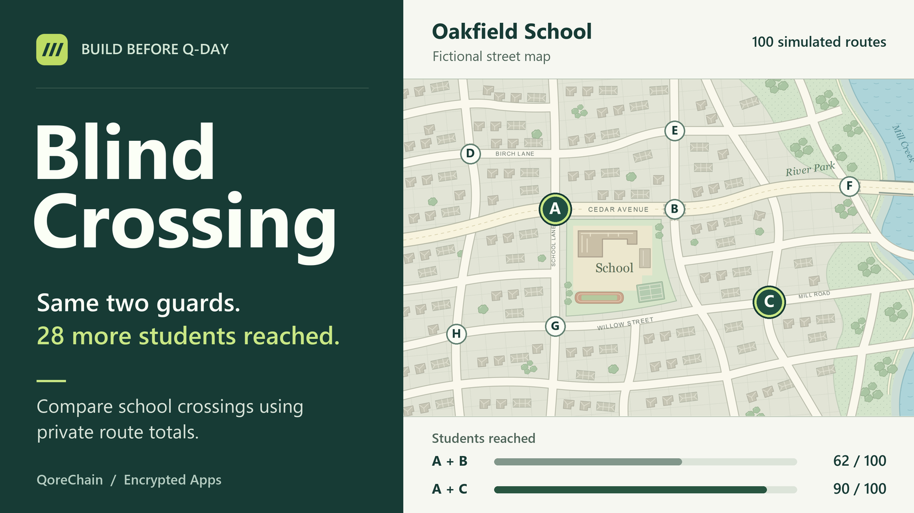

# Blind Crossing

[](https://build.qorechain.io/p/blind-crossing)

Choose two school crossings. Reach the most students. Keep each family's route private.

[Play the planner](https://tang-vu.github.io/blind-crossing/) · [Open a live room](https://tang-vu.github.io/blind-crossing/room.html) · [Watch the walkthrough](https://tang-vu.github.io/blind-crossing/planner-walkthrough.mp4) · [Download the signed Diana round](https://tang-vu.github.io/blind-crossing/diana.json)



## Try it in a minute

Two crossing guards are available at fictional Oakfield School. Start with **A + B**. A reaches 60 students and B reaches 55, but 53 pass both, so the pair reaches **62 of 100**. Drag guard 2 to C, tap C or choose it from the menu. Only 10 students pass both A and C. The new pair reaches **90 of 100**, an increase of **28** with the same staff. The comparison button also works when you arrive at the best pair first.

| Evidence | What has run |
| --- | --- |
| Planner | 100 deterministic fictional routes. The browser derives eight individual totals and all 28 pair totals. |
| Published Diana round | Three client processes on **one physical computer** each used a wallet registered for ML-DSA-87 and ML-KEM-1024. The signed totals are **AB = 1** and **AC = 2**. Diana recorded the commitment at block **10,376,251** on November 19, 2026. |
| QR room | Three isolated participant browsers on one computer completed a self-hosted room using the real Diana registry. All three participants and the coordinator independently verified the same downloaded counts. The public room also passed its rehearsal and disconnect checks. |
| Physical field trial | **0 confirmed adult participant devices.** Mobile-sized browser sessions count as software tests. First-time user comprehension timing is pending. |

The map and signed packet represent two different surveys. The downloadable planner dataset contains deliberately public synthetic routes. A private room exports the roster, fixed proposals, signatures and masked contributions.

The Diana transaction memo contains the commitment to the roster, questions and signed contributions. Its receipt records successful execution at **14:02:39 UTC**. The public bundle includes all six key registration transaction IDs. Select **Testnet** in the explorer header to view the transaction. [Diana receipt](https://api-testnet.qore.host/cosmos/tx/v1beta1/txs/8D96D299A0B758AAE71EFA9DCB36EC2840F73CD9A14CB25F6A0A5EED886250B9) · [Explorer](https://explore.qore.network/tx/8D96D299A0B758AAE71EFA9DCB36EC2840F73CD9A14CB25F6A0A5EED886250B9) · [Archived packet](evidence/diana.json)

## Independent verification

For the published round, download the ZIP and unzip it on any computer with Node 24. It includes the signed packet, a standalone verifier, all seven Diana receipts and a short guide. Run `node verify-round.mjs diana.json` in that folder, even with the website and network offline. [Download the complete verification kit](https://github.com/tang-vu/blind-crossing/releases/download/diana-round-1/blind-crossing-diana-round-1.zip)

Use Node 24. Clone this repository, run `npm ci`, then disconnect if you wish. The verifier needs only the JSON bundle and installed code. It runs without a web server or wallet. Deployment also produces a [single-file verifier](https://tang-vu.github.io/blind-crossing/verify-round.mjs) that runs under Node without installing packages.

```sh
npm run verify -- evidence/diana.json --expect=c4bb29c20c627198f7b07895448ea165a81bc785c99a3b55d97297eaae51bbcf
# With both downloaded files, verify signatures and totals offline
node verify-round.mjs diana.json
# With internet access, also check the six registrations and the anchor
node verify-round.mjs diana.json --chain
# Recompute the eight individual totals and 28 pair totals from the planner download
node verify-round.mjs simulation.json
```

To reproduce the missing-member test, remove one signed contribution from a copy. The CLI prints the missing wallet address and exits with code 1. The evidence panel offers the same experiment in the browser.

```sh
node -e "const fs=require('node:fs'),b=JSON.parse(fs.readFileSync('evidence/diana.json'));b.contributions.pop();fs.writeFileSync('incomplete.json',JSON.stringify(b))"
npm run verify -- incomplete.json
```

A bundle's own digest checks consistency. An independently obtained digest pins a particular published round. A Diana bundle supports `--chain` for checking historical registration receipts, the signer and the commitment against live Diana REST. This mode trusts that REST node's view of committed transactions. Offline checks authenticate the submitted values and recompute the sum.

## Run the project

```sh
npm ci
npm test
npm run build
npm start
```

Visit http://127.0.0.1:4173. To run a new three-process rehearsal, use `npm run round -- rehearsal another-round.json`. Output files must be new. Each process creates its own keys and seed material. Only signed envelopes and public protocol messages cross the process channels. The fourth process can verify the saved file independently.

For the browser integration check, start the built site, install a Playwright Chromium browser (`npx playwright install chromium`) and run `node tests/browser-smoke.mjs`. An installed Edge can be selected with the environment variable `BROWSER_CHANNEL=msedge`.

## Run a Diana round

1. Run `npm run wallets`. This creates three dedicated testnet wallets in the Git-ignored `.private/diana/` directory and prints their public addresses. Keep this local directory secure and backed up for future runs.
2. Sign in to the [testnet faucet](https://dashboard.qorechain.io/faucet) and fund the **first** printed address once. The first wallet covers the others' setup fees.
3. Run `npm run register`. The script checks the chain ID, simulates signed transactions, waits for successful delivery, and records registration hashes locally. It enrolls each ML-DSA-87 key before hybrid-signing the ML-KEM-1024 registration. Reruns reuse matching keys.
4. Run `npm run round -- diana round.json` in a checkout where that output file is new. Every client looks up every registered KEM and signing key before accepting the manifest. Each client checks its own identity and the coordinator compares all three manifest digests.
5. Run `npm run anchor -- round.json`. A hybrid-signed self-transfer of 1 uqor carries `blind-crossing/v1/<SHA-256>` in its memo. The digest covers the full roster, options and ordered signed contributions. The command checks enrollment and anchor receipts before adding their IDs to the public bundle.
6. Copy the resulting file to a second machine and run `npm run verify -- round.json --chain`. The CLI prints the anchor hash. Select Testnet in [QoreChain Explorer](https://explore.qore.network/) and open the transaction. The explicit Diana REST receipt is available under `https://api-testnet.qore.host/cosmos/tx/v1beta1/txs/<HASH>`.

The published round used these three Diana addresses. Anyone reproducing it can generate their own wallets.

```text
qor1ntg7c2cgxrayrfcnz28hndk3cpqqq2p8wqc26v
qor1lf8jns9z77ktfyppyterjnklvrpsawvdml3eyf
qor1vnh8z6ppwg4v0w26cl3vhd9e8lnt05p5ach03e
```

## Adult QR room

Open **Live room → Create room** on a coordinator screen. Invite 3–12 adults to scan its QR code. Each participant creates a temporary wallet on their device. Lock the roster, compare the fingerprint, wallet list and participant count on every screen, then confirm the two questions. Each device selects hypothetical crossings and sends a signed, masked vector. Every participant can download and verify the final packet.

The public QR room runs as an unanchored rehearsal with in-memory keys. GitHub Pages uses PeerJS Cloud for discovery and WebRTC data channels for traffic. The local server includes its own PeerServer. Remote phones need HTTPS for browser cryptography and a reachable signaling service. Use the public link or reverse-proxy the local server with TLS and WebSocket forwarding. Network restrictions can prevent WebRTC connections. Disconnecting after roster lock aborts the round. Start a new room to generate fresh keys and masks.

### Registered wallets on independent devices

The self-hosted HTTPS room also supports a Diana mode. Each adult can provision a dedicated Diana wallet on their own trusted computer with `npm run wallets -- one`, fund that address and run `npm run register -- one`. Then run `node scripts/diana.mjs device one`. It checks both public registries before writing the participant's private `.bc-device` file under `.private/diana/`. Securely transfer it only to that participant's own device. It contains the test wallet's message-signing and decryption secrets. The classical spending key and recovery phrase stay on the provisioning computer.

Select **Use registered Diana wallets** on the self-hosted coordinator before creating the QR invite. Each participant opens their own device file locally. The browser checks the full roster against Diana through the same-origin read-only registry relay before presenting the confirmation or route picker. Download the signed packet. One participating wallet owner can anchor it using their own `one` slot and the anchor command above. Registration receipts from other participants can be recovered from the public chain. The published three-client run is archived in `evidence/diana.json`. The registered browser flow was exercised on one computer. An adult trial on separate devices is pending.

The UI counts connected browser wallets. A facilitator records the actual number of physical devices and participating adults separately. Use fictional routes throughout the trial. Measure comprehension from opening the page until a first-time participant can explain the 28-student difference.

## Protocol and privacy

- The manifest fixes the chain, a fresh UUID, survey mode, sorted wallets, hybrid-signed recipient cards, public keys and two questions before any route input. Private rooms ask only AB and AC.
- For each pair, the lexicographically earlier wallet samples 32 random bytes. It signs a QoreSeal hybrid envelope to the peer using ML-KEM-1024 and X25519. The envelope authenticates the manifest digest and both addresses as associated data.
- Each device encodes one bit per proposal when its fictional route intersects either crossing. HMAC-SHA-256 derives a separate 32-bit mask per pair, manifest and proposal. One peer adds the mask and the other subtracts it modulo 2³².
- Each wallet signs its masked vector with ML-DSA-87. The verifier checks every required participant exactly once, verifies cards and contributions, checks vector dimensions and bounds, recomputes the commitment and adds the vectors. With every member present, masks cancel.
- Participants self-report. A signature cannot establish that a route is truthful or that each masked input began as a valid bit. Collusion by everyone except one participant can expose that person's answers. Small cohorts and correlated totals can reveal details even from valid aggregates. Roster comparison helps detect a coordinator substituting its own wallets. Wallets, peer network addresses, and transaction timing may be observable. The app requests no GPS, home addresses, names or child identifiers.
- This prototype aborts incomplete rounds. It does not implement dropout recovery, differential privacy, zero-knowledge input proofs or protection from a compromised device. The CLI demonstration runs multiple processes under one operating-system account.

## Data and credits

The development record describes the entrant's contributions, the work performed with Codex and the tests that verified the result. [AI usage](AI_USAGE.md)

The six disjoint ABC groups have sizes 10 (ABC), 43 (AB), 7 (A), 2 (B), 30 (C) and 8 (D–H). The last group is distributed 2, 2, 2, 1, 1. The generator and calculation are in [src/simulation.mjs](src/simulation.mjs).

Blind Crossing code and the original fictional street map are [MIT licensed](LICENSE). [QoreSeal](https://github.com/qorechain/qoreseal) supplies hybrid envelopes and recipient cards. [QoreSign](https://github.com/qorechain/qoresign) supplies wallet derivation, proof-of-possession registration and ML-DSA signatures. Both QoreChain kits are Apache-2.0. The transaction flow follows their register-and-send and register-and-encrypt examples. Cosmos message encoding uses CosmJS and cosmjs-types. noble and scure provide hash, mnemonic and encoding implementations. PeerJS, PeerServer and node-qrcode support the browser room. esbuild packages the app. Browser dependency licenses ship at [THIRD-PARTY.txt](https://tang-vu.github.io/blind-crossing/THIRD-PARTY.txt).

Pairwise masking is inspired by Bonawitz et al., [Practical Secure Aggregation](https://arxiv.org/abs/1611.04482). Project category: Encrypted Apps, Build Before Q-Day, QoreChain Diana testnet.
